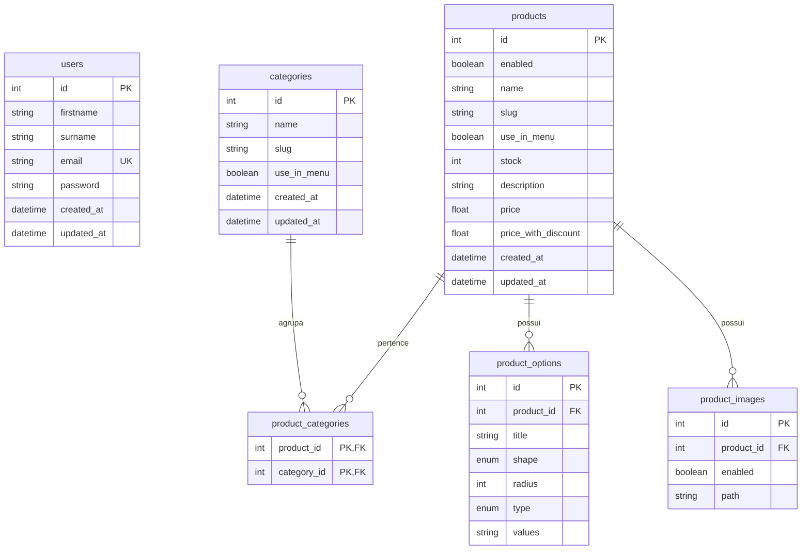

# Digital Store API — Projeto Final Backend (Geração Tech)

API RESTful de E-commerce desenvolvida com **Node.js**, **Express**, **Sequelize ORM**, **MySQL**, **JWT**, **bcrypt**, **Swagger (OpenAPI 3.0)** e **Jest**, seguindo o escopo oficial do repositório [digitalcollegebr/projeto-backend](https://github.com/digitalcollegebr/projeto-backend).

---

## Sumário

- [Funcionalidades](#funcionalidades)
- [Tecnologias Utilizadas](#tecnologias-utilizadas)
- [Arquitetura e Estrutura de Diretórios](#arquitetura-e-estrutura-de-diretórios)
- [Modelagem do Banco de Dados](#modelagem-do-banco-de-dados)
- [Guia de Instalação e Execução (Setup)](#guia-de-instalação-e-execução-setup)
- [Documentação da API (Swagger)](#documentação-da-api-swagger)
- [Referência dos Endpoints](#referência-dos-endpoints)
- [Testes Automatizados](#testes-automatizados)

---

## Funcionalidades

- **Usuários (`/v1/user`)**: cadastro com senha criptografada via `bcrypt`, consulta por ID (sem expor a senha), atualização e remoção.
- **Autenticação JWT (`/v1/user/token`)**: geração de token Bearer JWT e middleware de proteção (`401 Unauthorized`) para rotas de escrita (`POST`, `PUT` e `DELETE` protegidas).
- **Categorias (`/v1/category`)**: CRUD completo + busca com paginação (`limit`, `page`, `limit=-1`), projeção de campos (`fields`) e filtro `use_in_menu`.
- **Produtos (`/v1/product`)**: CRUD completo transacional com associação N:N de categorias, upload de imagens em base64 (salvas no servidor e servidas em `/media`) ou URLs externas, gerenciamento de variações/opções (`shape`, `radius`, `type`, `values`) e busca avançada com filtros combináveis (`limit`, `page`, `fields`, `match`, `category_ids`, `price-range`, `option[ID]`).
- **Tratamento Centralizado de Erros**: respostas HTTP padronizadas (`200`, `201`, `204`, `400`, `401`, `404`, `500`), incluindo validação de JSON malformado e erros de integridade do banco.
- **Documentação Swagger**: interface interativa OpenAPI 3.0 em `/api-docs` com suporte a autenticação Bearer JWT.
- **Migrations e Seeders**: versionamento completo do schema do banco com `sequelize-cli`.

---

## Tecnologias Utilizadas

| Categoria | Tecnologia |
| --- | --- |
| Runtime & Framework | Node.js, Express.js |
| Banco de Dados & ORM | MySQL 8, Sequelize, Sequelize CLI (`mysql2`) |
| Segurança & Auth | JSON Web Token (`jsonwebtoken`), `bcrypt`, `helmet`, `cors` |
| Configuração | `dotenv`, `nodemon`, Docker Compose |
| Documentação | Swagger UI (`swagger-ui-express`, OpenAPI 3.0.3) |
| Testes | Jest, Supertest, SQLite em memória (ou MySQL) |

---

## Arquitetura e Estrutura de Diretórios

O projeto segue o padrão **MVC com Camada de Serviços (Service Layer)** e princípios **SOLID** (Responsabilidade Única em controllers, serviços, validadores, persistência de mídia e tratamento de erros):

```text
projeto-final-backend-Gera-o-tech/
├── src/
│   ├── config/
│   │   ├── config.js          # Configuração de ambientes do Sequelize CLI
│   │   ├── database.js        # Instância única de conexão Sequelize
│   │   └── swagger.js         # Especificação OpenAPI 3.0.3 (Swagger)
│   ├── controllers/
│   │   ├── userController.js
│   │   ├── categoryController.js
│   │   └── productController.js
│   ├── database/
│   │   ├── migrations/        # 6 migrations versionadas (tabelas, FKs e índices)
│   │   └── seeders/           # Dados iniciais opcionais para testes manuais
│   ├── middleware/
│   │   ├── authMiddleware.js  # Validação de Bearer JWT
│   │   └── errorHandler.js    # Tratamento centralizado de erros e 404
│   ├── models/
│   │   ├── index.js           # Registro de modelos e associações (1:N e N:N)
│   │   ├── User.js
│   │   ├── Category.js
│   │   ├── Product.js
│   │   ├── ProductImage.js
│   │   ├── ProductOption.js
│   │   └── ProductCategory.js
│   ├── routes/
│   │   ├── index.js
│   │   ├── userRoutes.js
│   │   ├── categoryRoutes.js
│   │   └── productRoutes.js
│   ├── services/
│   │   ├── userService.js
│   │   ├── categoryService.js
│   │   ├── productService.js
│   │   └── imageService.js    # Persistência segura de imagens base64 e URLs
│   ├── utils/
│   │   ├── AppError.js        # Classe padronizada de erros HTTP
│   │   └── validators.js      # Validadores e parsers de query/payload
│   ├── app.js                 # Configuração da aplicação Express
│   └── server.js              # Ponto de entrada e inicialização HTTP
├── tests/
│   ├── setup.js               # Bootstrap isolado de banco e uploads de teste
│   ├── helpers.js             # Utilitários compartilhados de teste
│   ├── auth.test.js           # Testes de JWT, proteção de rotas e Swagger
│   ├── user.test.js           # Testes do CRUD de usuários
│   ├── category.test.js       # Testes do CRUD e busca de categorias
│   └── product.test.js        # Testes do CRUD, imagens, opções e filtros de produtos
├── uploads/                   # Armazenamento local das imagens enviadas
├── .env.example               # Modelo de variáveis de ambiente
├── .gitignore
├── .sequelizerc               # Mapeamento de caminhos do Sequelize CLI
├── docker-compose.yml         # Container MySQL 8 pronto para desenvolvimento
├── jest.config.js
└── package.json
```

---

## Modelagem do Banco de Dados

O banco relacional possui **6 tabelas** criadas via Migrations do Sequelize com chaves estrangeiras (`ON UPDATE CASCADE`, `ON DELETE CASCADE`) e índices nas colunas de busca frequente (`email`, `slug`, `use_in_menu`, `price`, `enabled`, `product_id`, `category_id`):



---

## Guia de Instalação e Execução (Setup)

### 1. Pré-requisitos

- **Node.js** 18+ (recomendado 20 ou 22)
- **npm** 9+
- **MySQL 8** local ou **Docker / Docker Compose**

### 2. Clonar o repositório e instalar dependências

```bash
git clone https://github.com/uquirino2/projeto-final-backend-Gera-o-tech.git
cd projeto-final-backend-Gera-o-tech
npm install
```

### 3. Configurar as variáveis de ambiente

Copie o arquivo `.env.example` para `.env` e ajuste os valores conforme seu ambiente:

```bash
cp .env.example .env
```

Principais variáveis:

```env
NODE_ENV=development
PORT=3000
APP_URL=http://localhost:3000

DB_DIALECT=mysql
DB_HOST=127.0.0.1
DB_PORT=3306
DB_NAME=digital_store_db
DB_USER=root
DB_PASSWORD=root

JWT_SECRET=sua_chave_secreta_super_segura_aqui
JWT_EXPIRES_IN=24h
UPLOAD_DIR=uploads
```

### 4. Subir o banco de dados MySQL

**Opção A — Usando Docker Compose (recomendado):**

```bash
docker compose up -d
```

**Opção B — Usando MySQL já instalado localmente:**

Crie o banco definido em `DB_NAME` (ex.: `CREATE DATABASE digital_store_db;`).

### 5. Executar as Migrations (e opcionalmente o Seeder)

```bash
# Criar todas as tabelas no banco de dados
npm run db:migrate

# (Opcional) Popular dados iniciais de demonstração
# Usuário demo: admin@mail.com | Senha: 123@123
npm run db:seed
```

Para reverter migrations ou seeders:

```bash
npm run db:seed:undo
npm run db:migrate:undo:all
```

### 6. Iniciar o servidor

```bash
# Modo desenvolvimento (com reload automático via nodemon)
npm run dev

# Modo produção
npm start
```

A API estará disponível em `http://localhost:3000` (verificação de saúde em `GET /health`).

---

## Documentação da API (Swagger)

Com o servidor em execução, acesse a documentação interativa **Swagger UI**:

- **Interface Interativa:** `http://localhost:3000/api-docs`
- **Especificação OpenAPI JSON:** `http://localhost:3000/api-docs.json`

Para testar rotas protegidas diretamente no Swagger:
1. Crie um usuário em `POST /v1/user` (ou utilize o usuário do seeder `admin@mail.com` / `123@123`).
2. Obtenha o token em `POST /v1/user/token`.
3. Clique no botão **Authorize** no topo da página do Swagger e informe o token JWT.

---

## Referência dos Endpoints

### Autenticação e Usuários

| Método | Rota | Auth JWT | Status Esperados | Descrição |
| --- | --- | :---: | --- | --- |
| `POST` | `/v1/user/token` | Não | `200`, `400` | Autentica usuário e retorna `{ "token": "<JWT>" }` |
| `GET` | `/v1/user/:id` | Não | `200`, `404` | Consulta usuário pelo ID (sem expor a senha) |
| `POST` | `/v1/user` | Não | `201`, `400` | Cadastra novo usuário (senha com hash bcrypt) |
| `PUT` | `/v1/user/:id` | **Sim** | `204`, `400`, `401`, `404` | Atualiza dados do usuário |
| `DELETE` | `/v1/user/:id` | **Sim** | `204`, `401`, `404` | Remove usuário pelo ID |

### Categorias

| Método | Rota | Auth JWT | Status Esperados | Descrição |
| --- | --- | :---: | --- | --- |
| `GET` | `/v1/category/search` | Não | `200`, `400` | Lista categorias (`limit`, `page`, `fields`, `use_in_menu`) |
| `GET` | `/v1/category/:id` | Não | `200`, `404` | Consulta categoria pelo ID |
| `POST` | `/v1/category` | **Sim** | `201`, `400`, `401` | Cria nova categoria |
| `PUT` | `/v1/category/:id` | **Sim** | `204`, `400`, `401`, `404` | Atualiza categoria pelo ID |
| `DELETE` | `/v1/category/:id` | **Sim** | `204`, `401`, `404` | Remove categoria pelo ID |

### Produtos

| Método | Rota | Auth JWT | Status Esperados | Descrição |
| --- | --- | :---: | --- | --- |
| `GET` | `/v1/product/search` | Não | `200`, `400` | Busca produtos (`limit`, `page`, `fields`, `match`, `category_ids`, `price-range`, `option[ID]`) |
| `GET` | `/v1/product/:id` | Não | `200`, `404` | Consulta produto completo pelo ID |
| `POST` | `/v1/product` | **Sim** | `201`, `400`, `401` | Cria produto com categorias, imagens (base64/URL) e opções |
| `PUT` | `/v1/product/:id` | **Sim** | `204`, `400`, `401`, `404` | Atualiza produto e sincroniza categorias, imagens e opções |
| `DELETE` | `/v1/product/:id` | **Sim** | `204`, `401`, `404` | Remove produto e todos os seus relacionamentos |

> **Nota sobre HTTP 401 Unauthorized:** Conforme definido nos requisitos individuais de cada endpoint protegido (`PUT`/`DELETE` de usuários e `POST`/`PUT`/`DELETE` de categorias e produtos) e na semântica HTTP (RFC 7235), requisições sem cabeçalho `Authorization: Bearer <token>` ou com token inválido/expirado retornam **401 Unauthorized**. Os endpoints `POST /v1/user` (cadastro) e `POST /v1/user/token` (login) são públicos para permitir o fluxo de onboarding e autenticação.

---

## Testes Automatizados

A suíte de testes com **Jest** e **Supertest** cobre autenticação JWT, todos os endpoints CRUD, validações, uploads de imagem, filtros combinados de busca, tratamento de erros e especificação Swagger.

Por padrão, os testes rodam em banco **SQLite em memória** (zero configuração externa necessária):

```bash
# Executar toda a suíte de testes
npm test

# Executar testes com relatório de cobertura
npm run test:coverage
```

Para executar a mesma suíte diretamente contra uma instância **MySQL**:

```bash
DB_DIALECT=mysql DB_TEST_NAME=digital_store_db npm test
```